# Tape

Tape is a unit converter for iPhone that works with no signal. Type one number, pick its unit, and you see it in every other unit of that category at once.

It comes from the same place as [Pocket](https://github.com/akintola4/pocket): small phone tools that keep working offline. Tape has no network code at all. It also knows the unit people around me actually buy land in, the plot.

It isn't on the App Store. You clone it, open it in Xcode and run it on your own phone.

<p align="center">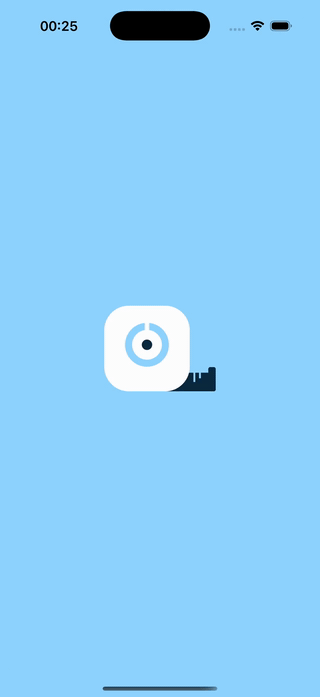</p>

When it opens, the tape pulls out of its case and snaps back, then the converter settles in behind it. It plays once per cold launch, and a tap skips it. With Reduce Motion on, it fades instead.

## Screenshots

| Area (light) | Area (dark) | Length |
|---|---|---|
| 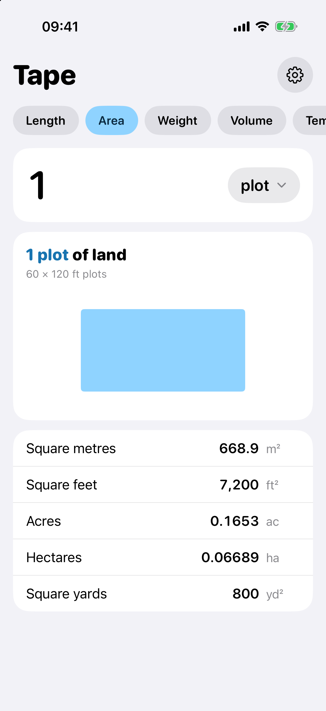 | 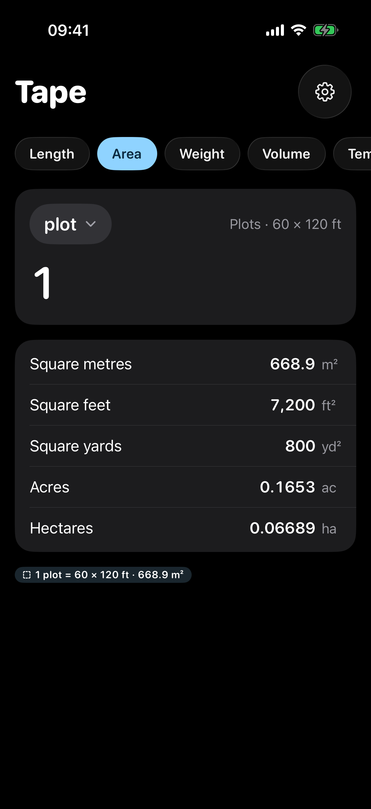 | 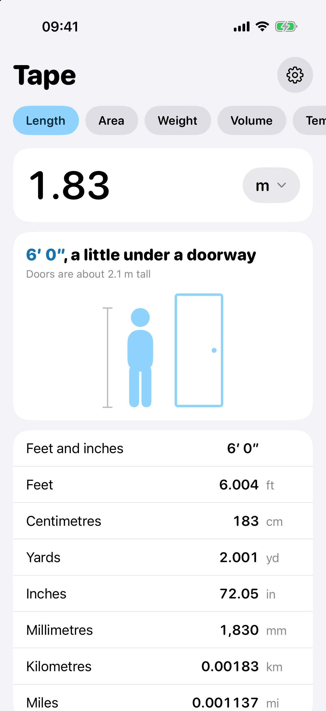 |

| An acre in plots | Temperature | Copied |
|---|---|---|
| 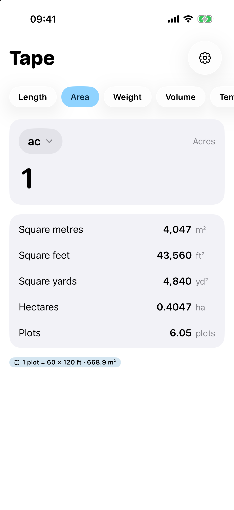 | 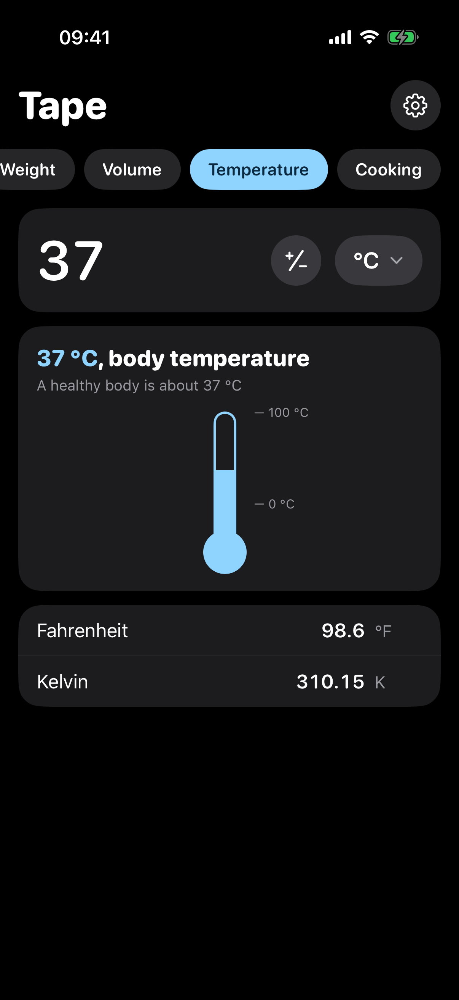 | 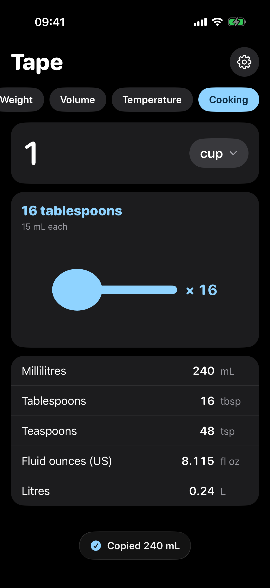 |

| Settings (light) | Settings (dark) |
|---|---|
| 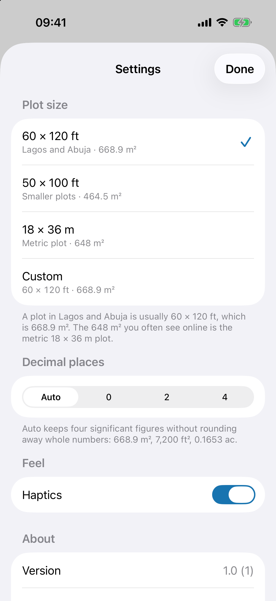 | 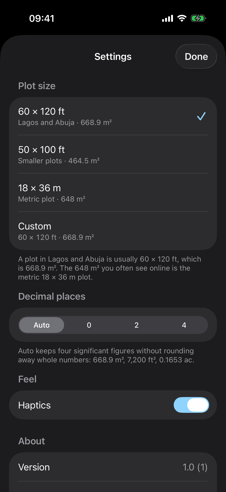 |

`scripts/screenshots.sh` takes all of these in the Simulator using the launch arguments below.

### Picture it

| 1 acre (light) | 70 kg (dark) | 6 ft (light) |
|---|---|---|
| 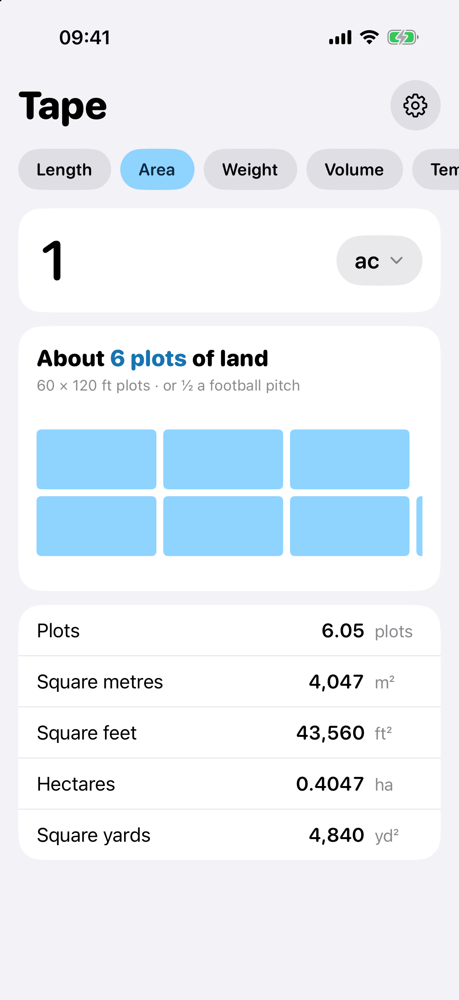 | 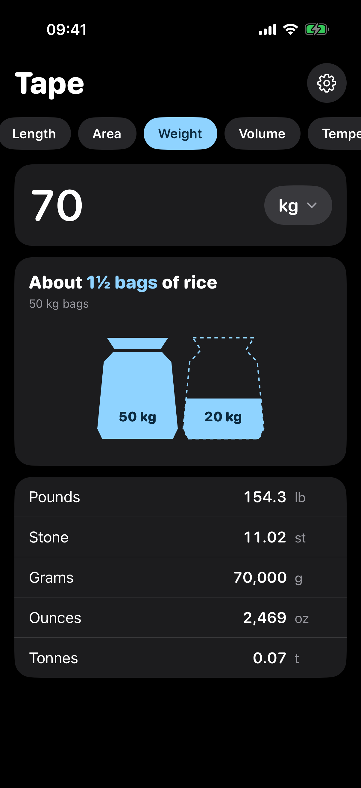 | 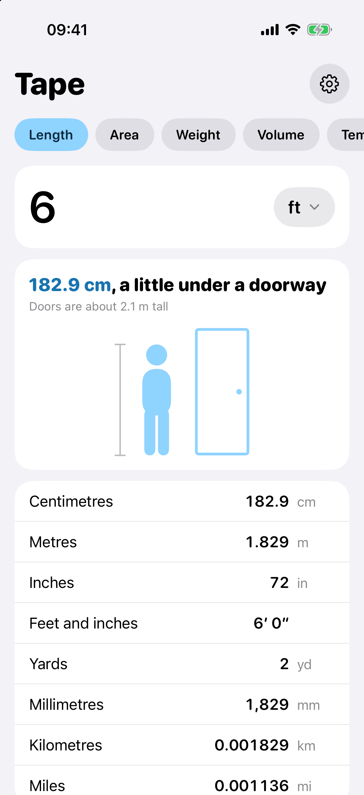 |

### Widgets

| Home Screen (light) | Home Screen (dark) |
|---|---|
| 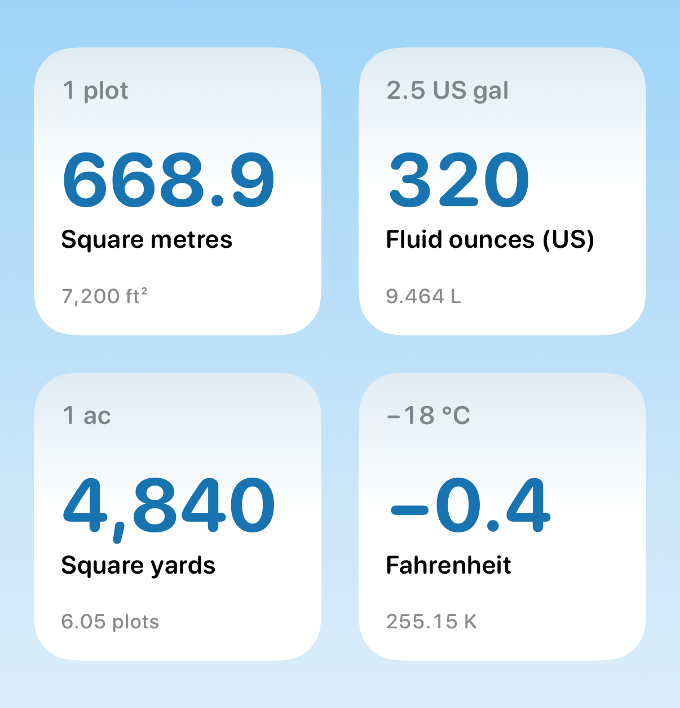 | 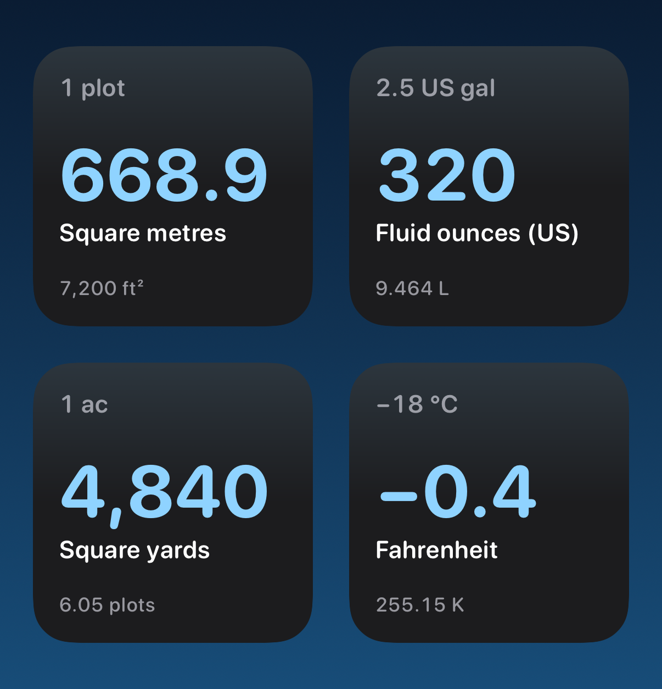 |

| Lock Screen | Lock Screen, long units |
|---|---|
| 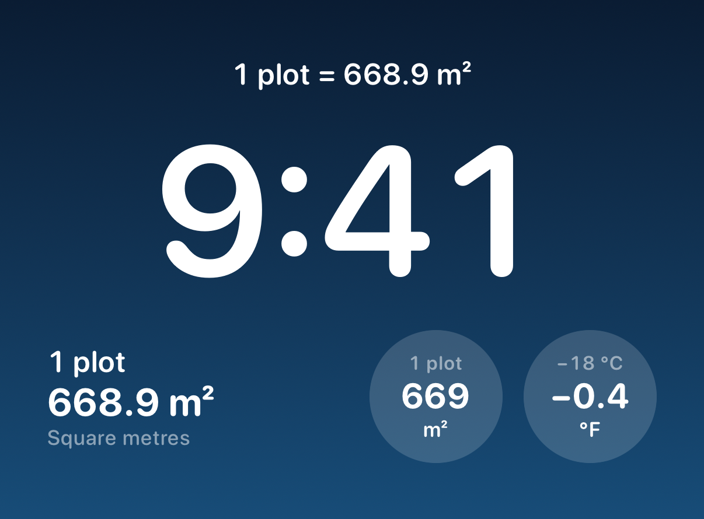 | 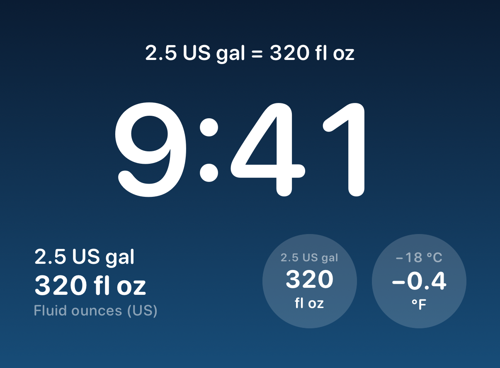 |

The Simulator can't add a widget without tapping, so `scripts/widget-screenshots.sh` renders the real widget views with `ImageRenderer` in a test and puts them on a stand-in Home Screen and Lock Screen. The wallpaper and the clock are stand-ins, but the widgets are the same views the extension draws.

## What it does

- Six categories: length, area, weight, volume, temperature and cooking.
- Under the number, a drawing pictures the amount with something you already know the size of: plots of land, 50 kg bags of rice, a person next to a door, cups, a thermometer. It picks the object by size, so a few grams are Maggi cubes and a few tonnes are cars, and it redraws as you type.
- Every other unit in the category is listed below that, most useful first (plots when you type acres, pounds when you type kilograms, centimetres when you type feet), and updates as you type. The values line up on the right against a fixed slot for the unit, so 668.9 m² and 6.05 plots end at the same place. Number formatting follows your phone's region.
- Tap a row to copy it with its unit, for example "668.9 m²". A small toast confirms it, and you get a light tap if haptics are on. Long-press a row to type in that unit instead.
- Rounding keeps four significant figures without rounding away whole numbers: 668.9 m², 7,200 ft², 0.1653 ac. Float noise like 0.30000000000000004 never reaches the screen. In Settings you can switch to a fixed 0, 2 or 4 decimal places.
- Length has a feet-and-inches row, so 1.83 m reads as 6′ 0″.
- Temperature uses the real formulas with their offsets, so 0 °C is 32 °F and not 0 °F. A ± key handles values below zero, since the number pad has no minus.
- Negative numbers use a real minus sign (−, U+2212) everywhere: the list, the amount field, Picture it and the widgets. It's longer than a hyphen and sits level with the digits. You can still paste or type a hyphen; Tape swaps it.
- Tape remembers the last category you used, plus the unit and amount for each category.
- Widgets for the Lock Screen and the Home Screen show one conversion you pick. More on those below.

## Widgets

Tape converts without data, so its widgets do too. Each one shows a single conversion. Out of the box that's 1 plot in square metres, using the plot size from Settings: change the plot to 18 × 36 m in the app and the widget changes to 648 m².

- Lock Screen, rectangular: the amount and unit, the answer big, then the answer's unit spelled out ("Square metres").
- Lock Screen, inline (the line above the clock): "1 plot = 668.9 m²", or just "668.9 m²" if the whole thing doesn't fit.
- Lock Screen, circular: a small "1 plot" label, then "669" and "m²". The number is rounded to three figures, with K and M past ten thousand.
- Home Screen, small: the amount on top, the answer big in baby blue, the unit's name, and one more unit underneath ("7,200 ft²").

To change what a widget shows, long-press it and choose Edit Widget. You pick a category, the unit and amount to convert, and the unit for the answer. The unit lists follow the category. If you switch category and leave the old units behind, the widget falls back to that category's usual units instead of showing nonsense.

Tapping a widget opens Tape on that category, unit and amount. It does this with a `tape://open?category=area&unit=plot&amount=1` link.

To add one:

- Lock Screen: touch and hold the Lock Screen, tap Customize, pick the Lock Screen, tap the widget area under the clock (or the date above it for the inline one), and choose Tape.
- Home Screen: touch and hold an empty spot, tap Edit, then Add Widget, search for Tape and add the small widget.

The app and the widget share settings through an App Group, `group.<your prefix>.tape`. Older versions kept settings in the app's own defaults, so on first launch Tape copies them across once and never overwrites anything already in the group.

### Units

| Category | Units |
|---|---|
| Length | mm, cm, m, km, in, ft, yd, mi, and feet and inches |
| Area | m², ft², yd², acres, hectares, plots |
| Weight | g, kg, lb, oz, stone, tonnes |
| Volume | mL, L, US gallons, UK gallons, US fl oz, m³ |
| Temperature | °C, °F, K |
| Cooking | cups (240 ml), tablespoons (15 ml), teaspoons (5 ml), mL, L, US fl oz |

Conversions go through Foundation's `Dimension` units. Foundation rounds a few of its coefficients, for example the pound as 0.453592 kg, so Tape defines those with their exact legal values: 0.45359237 kg to the pound, 3.785411784 L to the US gallon.

## A note on plots

In Lagos and Abuja a plot of land is usually 60 × 120 ft. That's 7,200 ft², or 668.9 m². I kept seeing websites say a plot is 648 m², and for a 60 × 120 ft plot that's wrong: 648 m² is the metric 18 × 36 m plot, about 21 m² smaller. Tape gets this right by default.

Plots aren't the same size everywhere, so you can change it in Settings:

- 60 × 120 ft, 668.9 m² (Lagos and Abuja; the default)
- 50 × 100 ft, 464.5 m²
- 18 × 36 m, 648 m²
- Custom, any width × length in feet or metres

On the default plot, an acre is 6.05 plots and a plot is 0.1653 acres.

## Build and run

You need Xcode 27 and a phone or simulator on iOS 26.1 or later. There are no packages and no API keys.

```bash
git clone https://github.com/akintola4/tape.git
cd tape
open Tape.xcodeproj
```

Pick the Tape scheme and a simulator (I use iPhone 17 Pro), then press Run. You don't need to set up signing for the Simulator.

### On your own iPhone

1. Create `Config/Local.xcconfig`. It's git-ignored, so your details stay out of the repo:

   ```
   TAPE_BUNDLE_PREFIX = com.yourname
   DEVELOPMENT_TEAM = YOURTEAMID
   ```

   `Config/Tape.xcconfig` includes it if it exists. You can also edit `Tape.xcconfig` directly, or leave the team empty and choose it under Signing & Capabilities. The bundle IDs (`<prefix>.tape`, `<prefix>.tape.widget`) and the App Group (`group.<prefix>.tape`) are all built from `TAPE_BUNDLE_PREFIX`, so that's the only name to change.
2. Plug in your phone, select it and press Run. The first time, go to Settings › General › VPN & Device Management on the phone and trust your developer certificate.

From the command line, let Xcode create the provisioning profiles and register the App Group for you:

```bash
xcodebuild build -scheme Tape -destination 'id=<your iPhone UDID>' -allowProvisioningUpdates
```

App Groups work with a free Apple ID. The widget extension lives inside the app, so it doesn't count against the free account's limit of three apps.

With a free Apple ID, an app you install from Xcode stops opening after 7 days. Run it from Xcode again to get another 7. Your settings survive the reinstall. With a paid Apple Developer Program membership the install lasts a year.

### Tests

```bash
xcodebuild test -scheme Tape -destination 'platform=iOS Simulator,name=iPhone 17 Pro,OS=26.1'
```

There are 139 tests in `TapeTests`. 137 run every time; the other 2 render the widget screenshots and only run from `scripts/widget-screenshots.sh`. They cover the pure logic in `Shared/`:

- round trips between every pair of units in every category
- the exact definitions
- temperature offsets
- the plot presets (60 × 120 ft is 668.9 m², 18 × 36 m is 648 m², an acre is 6.05 plots)
- custom and zero-sized plots
- rounding and formatting in en_GB, fr_FR and de_DE
- the feet-and-inches split, including carrying 11.96″ up to the next foot
- parsing and cleaning typed input
- what's remembered between launches
- which object the drawing uses at each size, the friendly rounding (½, ¼, ¾), how many plots are drawn for each plot size, and the order of the list
- the true minus sign: −0.4 °F, −18 °C, and −40 °C coming out as −40 °F
- the opening animation's timing, as plain functions of time
- what each widget size says, the default widget, how widget settings that don't match resolve, the `tape://` link round trip, and copying settings into the App Group

Locales are pinned so the tests pass on any machine. Leave out `OS=26.1` if your iPhone 17 Pro simulator runs a newer iOS.

### Launch arguments (Debug builds)

A few are in the scheme, switched off. Turn them on under Product › Scheme › Edit Scheme › Run › Arguments, or pass them to `xcrun simctl launch`.

- `-TapeCategory area` opens on a category: `length`, `area`, `weight`, `volume`, `temperature` or `cooking`.
- `-TapeUnit plot` sets the input unit by its id, as listed in `Shared/UnitCatalog.swift`.
- `-TapeAmount 2.5` sets the amount.
- `-TapeOpenSettings` opens Settings on launch.
- `-TapeDemoToast` shows the "Copied" toast for the first row and leaves it up.
- `-TapeDemoTyping "2.5<<<80"` types into the amount field one key at a time (`<` deletes), for recording the drawing as it changes.
- `-TapeNoSplash` skips the opening animation, for screenshots.
- `-TapeSplashSlow` plays the opening animation 4× slower, for tuning it.
- `-TapeSplashAt 0.6` holds the opening animation at that many seconds in, for stills. It never moves on to the app.

None of them save anything. They only change what the app opens on.

### Scripts

- `scripts/screenshots.sh` builds Tape for the Simulator and takes the app screenshots in `docs/screenshots/`.
- `scripts/widget-screenshots.sh` renders the widget screenshots in `docs/screenshots/widgets/`.
- `scripts/record-splash.sh` records the opening animation in the Simulator at normal speed and 4× slow, into `~/Movies/Tape splash/`.
- `scripts/make-icon.py` draws the app icon. Run `python3 scripts/make-icon.py` to regenerate it (it needs Pillow).

## Project layout

```
Tape/              the app: ConverterView, PictureCard and its shapes, SettingsView, AppSettings, Splash/
TapeWidget/        the widget extension: the widget, its timeline and the Edit Widget options
Shared/            used by both: UnitsLogic, UnitCatalog, PictureLogic, WidgetLogic, the widget views,
                   PlotSize, TapePersistence, Theme, Tokens
TapeTests/         Swift Testing suites
Config/            Tape.xcconfig (bundle prefix, team, App Group), Info.plists, entitlements
scripts/           screenshots, widget screenshots, splash recording, the icon
```

## Colour

The main colour is baby blue, `#8FD3FF`. Dark mode uses it as it is. In light mode, `#8FD3FF` on white is only 1.6:1, which is too faint for text and icons, so the accent there is a deeper `#1874B0`. That's 5.0:1 on white and 4.5:1 on the grey cards. The active category chip stays light blue in both modes, with navy text on it.

## License

MIT. See [LICENSE](LICENSE).

Made by [DevAkintola](https://devakintola.com).
